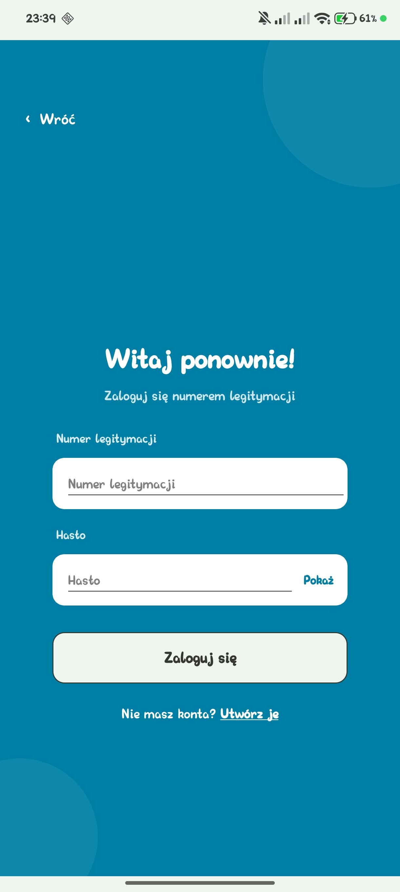
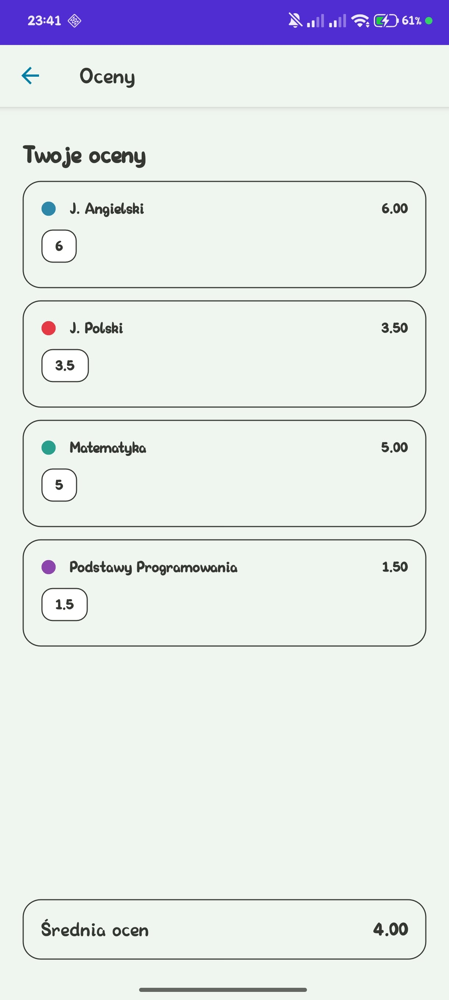
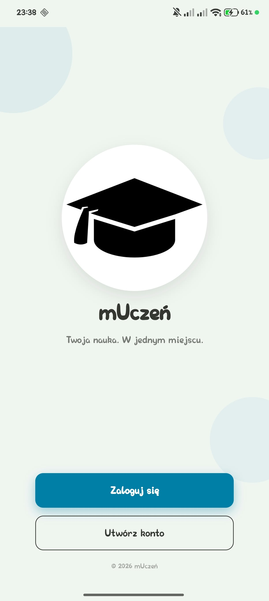
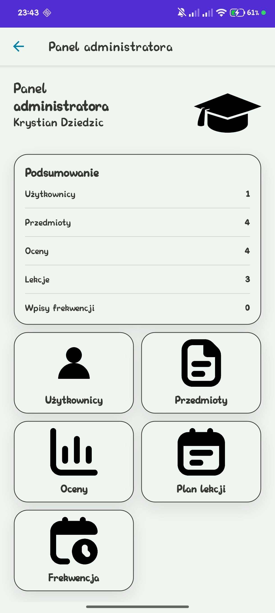

# mUczeń

Aplikacja mobilna dla uczniów, łącząca w jednym miejscu najważniejsze informacje szkolne: oceny, frekwencję, plan lekcji, zadania domowe i komunikaty.

Projekt zaliczeniowy (ZSTiO, kierunek technik programista).

## Jaki problem rozwiązuje?

Uczniowie na co dzień sprawdzają oceny, plan lekcji, frekwencję i komunikaty w kilku różnych, często niewygodnych miejscach (dziennik elektroniczny w przeglądarce, grupy klasowe, tablice ogłoszeń). mUczeń zbiera te informacje w jednej, prostej aplikacji mobilnej z czytelnym interfejsem i cyfrową legitymacją szkolną.

## Dla kogo jest aplikacja?

Dla uczniów szkół średnich — i dla nauczycieli/administracji, którzy przez panel administratora zarządzają uczniami, przedmiotami, ocenami, planem lekcji i frekwencją. Aplikacja jest generyczna — nie jest przypisana do jednej konkretnej szkoły, każdy użytkownik podaje przy rejestracji swoją szkołę i klasę.

## Technologie

- **.NET MAUI** (.NET 10) — C#, XAML
- **SQLite** (`sqlite-net-pcl`) — lokalna baza danych na urządzeniu
- **ASP.NET Core Identity** (`PasswordHasher`) — bezpieczne hashowanie haseł
- Platformy docelowe: Android (główna), iOS/MacCatalyst, Windows

## Funkcje — co już działa

- Rejestracja i logowanie (hasła hashowane, numer legitymacji jako login)
- Cyfrowa legitymacja uczniowska z danymi zalogowanego użytkownika
- **Oceny** — lista ocen pogrupowana po przedmiotach, z pojedynczymi ocenami i średnią
- **Frekwencja** — lista obecności/nieobecności z procentową frekwencją
- **Plan lekcji** — widok z zakładkami dni tygodnia (Pon–Pt)
- **Zadania** — lista zadań domowych z terminami
- **Komunikaty** — z filtrowaniem po kategorii (Szkoła / Klasa / Nauczyciele)
- **Panel administratora** (widoczny tylko dla kont z uprawnieniami admina) — zarządzanie uczniami, przedmiotami przypisanymi do klas, ocenami, planem lekcji i frekwencją
- Pierwszy zarejestrowany użytkownik automatycznie otrzymuje uprawnienia administratora

## Co jest planowane / w budowie

- Sekcja "Nadchodzące" na stronie głównej pokazuje obecnie przykładowe, statyczne dane — docelowo ma pobierać najbliższe lekcje, zadania i komunikaty z bazy
- Refaktor architektury do wzorca MVVM z Dependency Injection
- Wydzielenie powtarzalnych elementów UI do osobnych, reużywalnych komponentów
- Testy automatyczne i GitHub Actions (CI)

## Jak uruchomić projekt

Wymagania:
- Visual Studio 2022 (17.12+) z obciążeniem **.NET Multi-platform App UI development**, lub .NET 10 SDK + `dotnet workload install maui`

Kroki:
```bash
git clone https://github.com/krystian-dziedzic/mUczen.git
cd mUczen
dotnet workload restore
dotnet build -t:Run -f net10.0-android
```
Aplikację można też otworzyć i uruchomić bezpośrednio w Visual Studio, wybierając jako cel emulator Android (lub inną skonfigurowaną platformę).

Baza SQLite tworzy się automatycznie przy pierwszym uruchomieniu w katalogu danych aplikacji.

## Zespół

- [Krystian Dziedzic](https://github.com/krystian-dziedzic)
- [Wojciech Kapera](https://github.com/wojciech-kapera)

## Zrzuty ekranu

| Logowanie | Rejestracja |
|---|---|---|
|  |  |

| Oceny | Strona główna | Panel administratora |
|---|---|---|
|  |  |  |

## Licencja

Projekt na licencji MIT — zobacz [LICENSE](LICENSE).